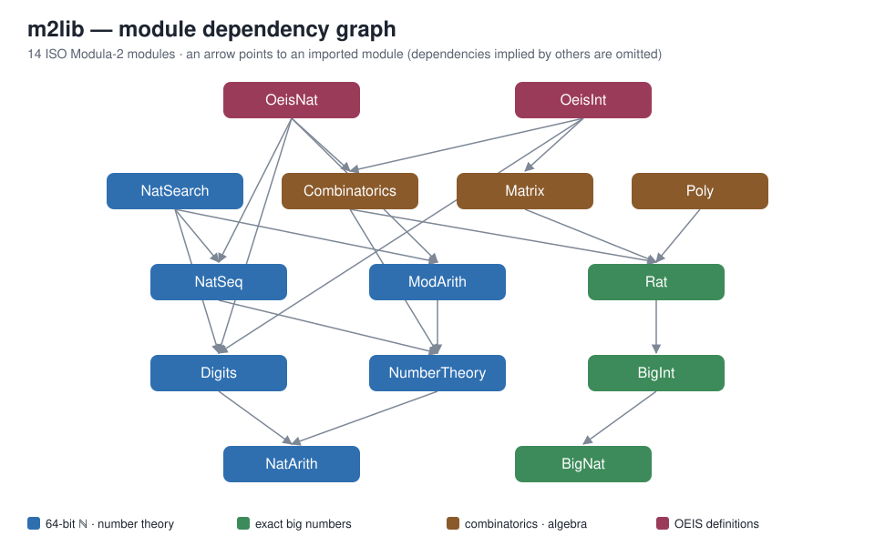

# m2lib


This library computes the definitions used by [google-deepmind/formal-conjectures](https://github.com/google-deepmind/formal-conjectures) (Lean 4 and Mathlib) exactly, as GNU Modula-2 modules. It uses no floating point and no approximation. Every limit is explicit: if a true value would not fit, the procedure returns `FALSE` rather than a wrong or approximate number.



## Contents

- [Quick start](#quick-start)
- [Modules](#modules)
- [Full inventory](#full-inventory)
- [Using the library](#using-the-library)
- [Tests](#tests)
- [Limits and gaps](#limits-and-gaps)
- [Layout](#layout)

## Quick start

```sh
# gm2 ships with GCC 13 or later (configure with --enable-languages=c,m2)
GM2=/path/to/gm2 GM2LIB=/path/to/gcc/lib64 ./build.sh
```

`build.sh` does the following:

1. Compiles every module with `gm2 -fiso -c`.
2. Links and runs the five test programs.
3. Checks that the deliberately wrong program `tests/expect_fail/FailCheck` fails.

Each command is printed with its exit status (`[exit N] …`). The script exits non-zero if any step fails. The result of the last run (x86_64 Linux, gm2 13.3.0):

| Program | Passed | Failed |
|---|---|---|
| TestCore | 1673 | 0 |
| TestBig | 980 | 0 |
| TestSeq | 86 | 0 |
| TestSearch | 167 | 0 |
| TestOeis | 559 | 0 |
| FailCheck | 0 | 2 (required to fail) |

## Modules

| Module | What it provides | Procedures | Lines¹ |
|---|---|---|---|
| [NatArith](src/NatArith.def) | Lean ℕ on 64 bits: truncated subtraction, `x/0 = 0`, `x%0 = x`, `Nat.sqrt`, `Nat.log`, bitwise ops | 25 | 229 |
| [NumberTheory](src/NumberTheory.def) | gcd/lcm, primes, `minFac`, π, Ω/ω, `padicValNat`, `factorization`, σₖ, φ, μ, Legendre/Jacobi | 32 | 434 |
| [ModArith](src/ModArith.def) | Modular inverse, CRT, Miller–Rabin, Pollard–Brent, order, Carmichael λ, primitive roots, Tonelli–Shanks, BSGS | 14 | 400 |
| [Digits](src/Digits.def) | `Nat.digits` (incl. base 0 / base 1 edge cases), `ofDigits`, digit sums, reversal, palindromes, concatenation | 13 | 193 |
| [NatSeq](src/NatSeq.def) | `List ℕ` / `Finset ℕ`: ranges, filter, map, sum, prod, sort, dedup, set operations, divisors, prime factors | 42 | 531 |
| [NatSearch](src/NatSearch.def) | `Nat.count`, bounded `Nat.nth` / `Nat.find`, 20 predicates (perfect, abundant, weird, practical, Carmichael, …) | 26 | 254 |
| [BigNat](src/BigNat.def) | Exact naturals up to 8192 bits: Knuth D division, Newton √, gcd/lcm, decimal I/O | 22 | 379 |
| [BigInt](src/BigInt.def) | Signed exact integers, Euclidean `Int.ediv` / `Int.emod`, `toNat`, `natAbs` | 23 | 209 |
| [Rat](src/Rat.def) | ℚ in lowest terms, `x/0 = 0`, `0⁻¹ = 0`, integer powers, floor/ceil | 25 | 228 |
| [Combinatorics](src/Combinatorics.def) | Factorials, binomials, Fibonacci/Lucas, Catalan, partitions, derangements, Stirling, Bernoulli, harmonic | 20 | 319 |
| [Matrix](src/Matrix.def) | Integer and rational square matrices (n ≤ 16): exact Bareiss determinant, rank, inverse, powers, powers mod m | 15 | 374 |
| [Poly](src/Poly.def) | ℚ[X] up to degree 48: ring ops, eval, derivative, composition, division with remainder, monic gcd | 24 | 281 |
| [OeisNat](src/OeisNat.def) | 80 ℕ-valued sequence definitions transcribed from `FormalConjectures/OEIS/*.lean` | 80 | 1140 |
| [OeisInt](src/OeisInt.def) | 28 ℤ/ℚ-valued (or ℚ-mediated) sequence definitions from 26 OEIS files, plus `Int.xor` | 29 | 432 |
| **Total** | | **390** | **5403** |

¹ Non-blank lines in the `.def` and `.mod` files after removing comments.

### Conventions

- **Lean ℕ semantics:** `a - b` is truncated, `x / 0 = 0`, `x % 0 = x`, `0 ^ 0 = 1`.
- **Results that may not fit:** a `BOOLEAN` return value reports whether the exact result fits (`TRUE` means exact). The result itself goes in a `VAR` parameter.
- **Big numbers:** `BigNat`, `BigInt` and `Rat` are exact up to 8192 bits. Their results may be passed as the same variable as an argument.

## Full inventory

The tables below are taken from the `.def` interfaces. Click a module to expand it.

<details>
<summary><b>NatArith</b> — 25 procedures</summary>

| Procedure | Signature | Lean / Mathlib meaning |
|---|---|---|
| `Add` | `(a, b: LONGCARD; VAR r: LONGCARD) : BOOLEAN` | a + b; FALSE above 2^64 − 1 |
| `Mul` | `(a, b: LONGCARD; VAR r: LONGCARD) : BOOLEAN` | a * b; FALSE above 2^64 − 1 |
| `Pow` | `(a, e: LONGCARD; VAR r: LONGCARD) : BOOLEAN` | a ^ e (0 ^ 0 = 1); FALSE above 2^64 − 1 |
| `Sub` | `(a, b: LONGCARD) : LONGCARD` | truncated |
| `Div` | `(a, b: LONGCARD) : LONGCARD` | a / 0 = 0 |
| `Mod` | `(a, b: LONGCARD) : LONGCARD` | a % 0 = a |
| `Pred` | `(a: LONGCARD) : LONGCARD` | Nat.pred: pred 0 = 0 |
| `Min` | `(a, b: LONGCARD) : LONGCARD` | min a b |
| `Max` | `(a, b: LONGCARD) : LONGCARD` | max a b |
| `Dist` | `(a, b: LONGCARD) : LONGCARD` | Nat.dist: \|a - b\| |
| `Dvd` | `(a, b: LONGCARD) : BOOLEAN` | a ∣ b; 0 ∣ b iff b = 0 |
| `IsEven` | `(a: LONGCARD) : BOOLEAN` | Even a |
| `IsOdd` | `(a: LONGCARD) : BOOLEAN` | Odd a |
| `Sqrt` | `(n: LONGCARD) : LONGCARD` | Nat.sqrt: largest r with r * r <= n |
| `IsSquare` | `(n: LONGCARD) : BOOLEAN` | IsSquare n (∃ r, n = r * r) |
| `Log` | `(b, n: LONGCARD) : LONGCARD` | Nat.log b n; 0 when b <= 1 or n < b |
| `Log2` | `(n: LONGCARD) : LONGCARD` | Nat.log2; log2 0 = 0 |
| `Clog` | `(b, n: LONGCARD) : LONGCARD` | Nat.clog b n: least k with n <= b^k; 0 when b <= 1 or n <= 1 |
| `Xor` | `(a, b: LONGCARD) : LONGCARD` | a ^^^ b (Nat.xor) |
| `LAnd` | `(a, b: LONGCARD) : LONGCARD` | bitwise and (Nat.land) |
| `LOr` | `(a, b: LONGCARD) : LONGCARD` | bitwise or (Nat.lor) |
| `TestBit` | `(n, i: LONGCARD) : BOOLEAN` | Nat.testBit n i |
| `PopCount` | `(n: LONGCARD) : LONGCARD` | number of 1 bits (Nat.bits.count true) |
| `ShiftLeft` | `(a, k: LONGCARD; VAR r: LONGCARD) : BOOLEAN` | a <<< k; FALSE above 2^64 − 1 |
| `ShiftRight` | `(a, k: LONGCARD) : LONGCARD` | a >>> k (0 for k ≥ 64) |

</details>

<details>
<summary><b>NumberTheory</b> — 32 procedures</summary>

| Procedure | Signature | Lean / Mathlib meaning |
|---|---|---|
| `Gcd` | `(a, b: LONGCARD) : LONGCARD` | Nat.gcd; gcd 0 0 = 0 |
| `Lcm` | `(a, b: LONGCARD; VAR r: LONGCARD) : BOOLEAN` | Nat.lcm; lcm 0 x = 0 |
| `Coprime` | `(a, b: LONGCARD) : BOOLEAN` | Nat.Coprime a b (gcd = 1) |
| `AddMod` | `(a, b, m: LONGCARD) : LONGCARD` | (a + b) mod m, m > 0 |
| `MulMod` | `(a, b, m: LONGCARD) : LONGCARD` | (a * b) mod m, m > 0, no overflow |
| `PowMod` | `(a, e, m: LONGCARD) : LONGCARD` | a^e mod m; m = 1 gives 0; m = 0 gives 0 |
| `MinFac` | `(n: LONGCARD) : LONGCARD` | Nat.minFac: 0 ↦ 2, 1 ↦ 1 |
| `IsPrime` | `(n: LONGCARD) : BOOLEAN` | Nat.Prime |
| `NextPrime` | `(n: LONGCARD; VAR p: LONGCARD) : BOOLEAN` | least prime >= n |
| `NthPrime` | `(k: LONGCARD; VAR p: LONGCARD) : BOOLEAN` | Nat.nth Nat.Prime k; nth 0 = 2 |
| `PrimeCounting` | `(n: LONGCARD) : LONGCARD` | π n = #{p ≤ n prime} |
| `PrimeCountingBelow` | `(n: LONGCARD) : LONGCARD` | π' n = #{p < n prime} |
| `BigOmega` | `(n: LONGCARD) : LONGCARD` | Ω: prime factors with multiplicity; Ω 0 = 0 |
| `Omega` | `(n: LONGCARD) : LONGCARD` | ω: distinct prime factors; ω 0 = 0 |
| `PrimeFactorNth` | `(n, k: LONGCARD) : LONGCARD` | (primeFactorsList n)[k], 0 past the end |
| `MaxPrimeFac` | `(n: LONGCARD) : LONGCARD` | largest prime factor; 0 for n <= 1 |
| `PadicValNat` | `(p, n: LONGCARD) : LONGCARD` | padicValNat: 0 if p <= 1 or n = 0 |
| `Factorization` | `(n, p: LONGCARD) : LONGCARD` | n.factorization p: 0 unless p is prime |
| `Radical` | `(n: LONGCARD) : LONGCARD` | ∏ n.primeFactors; primeFactors 0 = ∅, so rad 0 = 1 |
| `SquarefreePart` | `(n: LONGCARD) : LONGCARD` | ∏ p^(e mod 2) over n.factorization |
| `IsSquarefree` | `(n: LONGCARD) : BOOLEAN` | Squarefree: 0 is not, 1 is |
| `IsPrimePow` | `(n: LONGCARD) : BOOLEAN` | n = p^k, p prime, k >= 1 |
| `IsPowerful` | `(n: LONGCARD) : BOOLEAN` | every prime factor divides with exponent >= 2 |
| `DivisorCount` | `(n: LONGCARD) : LONGCARD` | #n.divisors; 0 for n = 0 |
| `DivisorSigma` | `(k, n: LONGCARD; VAR r: LONGCARD) : BOOLEAN` | σ_k n = ∑_{d ∣ n} d^k; σ_k 0 = 0 |
| `ProperDivisorSum` | `(n: LONGCARD; VAR r: LONGCARD) : BOOLEAN` | ∑ n.properDivisors |
| `IsPerfect` | `(n: LONGCARD) : BOOLEAN` | Nat.Perfect: 0 < n ∧ ∑ properDivisors = n |
| `Totient` | `(n: LONGCARD) : LONGCARD` | φ; φ 0 = 0 |
| `Moebius` | `(n: LONGCARD) : INTEGER` | μ; μ 0 = 0 |
| `UnitaryDivisorCount` | `(n: LONGCARD) : LONGCARD` | 2^ω(n) for n > 0, 0 for n = 0 |
| `Legendre` | `(a: LONGINT; p: LONGCARD) : INTEGER` | legendreSym p a for prime p (p = 2: a mod 2) |
| `Jacobi` | `(a: LONGINT; b: LONGCARD) : INTEGER` | jacobiSym a b = ∏ over primeFactorsList b |

</details>

<details>
<summary><b>ModArith</b> — 14 procedures</summary>

| Procedure | Signature | Lean / Mathlib meaning |
|---|---|---|
| `ExtGcd` | `(a, b: LONGINT; VAR x, y: LONGINT) : LONGINT` | returns g = gcd(\|a\|, \|b\|) >= 0 and Bézout x, y with a x + b y = g (Int.gcdA / gcdB style; requires \|a\|, \|b\| < 2^62 so that the coefficients stay representable) |
| `Inverse` | `(a, m: LONGCARD; VAR r: LONGCARD) : BOOLEAN` | r = a⁻¹ mod m; FALSE if m = 0 or gcd(a, m) # 1; m = 1 gives r = 0 |
| `SubMod` | `(a, b, m: LONGCARD) : LONGCARD` | (a - b) mod m in ZMod m; m > 0 |
| `NegMod` | `(a, m: LONGCARD) : LONGCARD` | -a in ZMod m; m > 0 |
| `Crt` | `(a1, m1, a2, m2: LONGCARD; VAR x, m: LONGCARD) : BOOLEAN` | least x ≥ 0 with x ≡ a1 (m1), x ≡ a2 (m2), m = lcm; FALSE if inconsistent, m1 or m2 = 0, or lcm ≥ 2^64. Moduli need not be coprime. |
| `IsPrime` | `(n: LONGCARD) : BOOLEAN` | deterministic Miller–Rabin with bases 2,3,5,7,11,13,17,19,23,29,31,37 (exact below 3.3e24) |
| `PollardRho` | `(n: LONGCARD) : LONGCARD` | a non-trivial factor of a composite n > 3 (Brent's variant); n itself if n is prime or n ≤ 3 |
| `Factor` | `(n: LONGCARD; VAR f: Factored)` | n = ∏ p_i^e_i; count = 0 for n ≤ 1 (factorization 0 = 0 in Mathlib) |
| `MinFacFast` | `(n: LONGCARD) : LONGCARD` | = Nat.minFac n, using Factor |
| `Order` | `(a, m: LONGCARD) : LONGCARD` | orderOf (a : ZMod m): least k ≥ 1 with a^k = 1; 0 if gcd(a, m) # 1 or m = 0; 1 for m = 1 |
| `CarmichaelLambda` | `(n: LONGCARD; VAR r: LONGCARD) : BOOLEAN` | Carmichael λ(n); λ(1) = 1; λ(0) := 0; FALSE only on overflow (never for 64-bit n) |
| `PrimitiveRoot` | `(m: LONGCARD; VAR g: LONGCARD) : BOOLEAN` | least g in [1, m) of order φ(m); FALSE if none (m not 1, 2, 4, p^k or 2p^k); m = 1: g = 0 |
| `SqrtModPrime` | `(a, p: LONGCARD; VAR r: LONGCARD) : BOOLEAN` | least r with r^2 ≡ a (mod p), p prime (Tonelli–Shanks); FALSE if a is a non-residue or p is not prime |
| `DiscreteLog` | `(g, h, m: LONGCARD; VAR k: LONGCARD) : BOOLEAN` | least k ≥ 0 with g^k ≡ h (mod m), baby-step giant-step; m ≤ 2^40 (else FALSE) |

</details>

<details>
<summary><b>Digits</b> — 13 procedures</summary>

| Procedure | Signature | Lean / Mathlib meaning |
|---|---|---|
| `ToDigits` | `(b, n: LONGCARD; VAR l: List) : BOOLEAN` | FALSE: base 1 with n > MaxLen |
| `OfDigits` | `(b: LONGCARD; VAR l: List; VAR r: LONGCARD) : BOOLEAN` | ∑ d_i b^i |
| `Length` | `(b, n: LONGCARD) : LONGCARD` | (digits b n).length |
| `Sum` | `(b, n: LONGCARD) : LONGCARD` | (digits b n).sum |
| `At` | `(b, n, k: LONGCARD) : LONGCARD` | (digits b n)[k], 0 past the end |
| `Count` | `(b, n, d: LONGCARD) : LONGCARD` | (digits b n).count d |
| `Reverse` | `(b, n: LONGCARD; VAR r: LONGCARD) : BOOLEAN` | ofDigits b (digits b n).reverse |
| `IsPalindrome` | `(b, n: LONGCARD) : BOOLEAN` | digits b n = (digits b n).reverse |
| `Product` | `(b, n: LONGCARD; VAR r: LONGCARD) : BOOLEAN` | (digits b n).prod |
| `AllDistinct` | `(b, n: LONGCARD) : BOOLEAN` | (digits b n).Nodup |
| `ContainsDigit` | `(b, n, d: LONGCARD) : BOOLEAN` | d ∈ digits b n |
| `Concat` | `(a, b: LONGCARD; VAR r: LONGCARD) : BOOLEAN` | a * 10^(digits 10 b).length + b; so b = 0 gives a |
| `Bits` | `(n: LONGCARD; VAR l: List)` | Nat.bits as 0/1, least significant first |

</details>

<details>
<summary><b>NatSeq</b> — 42 procedures</summary>

| Procedure | Signature | Lean / Mathlib meaning |
|---|---|---|
| `Clear` | `(VAR l: T)` | [] |
| `Push` | `(VAR l: T; v: LONGCARD) : BOOLEAN` | l ++ [v] |
| `Range` | `(n: LONGCARD; VAR l: T) : BOOLEAN` | List.range n = [0, …, n-1] |
| `Icc` | `(a, b: LONGCARD; VAR l: T) : BOOLEAN` | [a, b]; empty if a > b |
| `Ico` | `(a, b: LONGCARD; VAR l: T) : BOOLEAN` | [a, b) |
| `Ioc` | `(a, b: LONGCARD; VAR l: T) : BOOLEAN` | (a, b] |
| `Get` | `(VAR l: T; i: LONGCARD) : LONGCARD` | l.getD i 0 |
| `Head` | `(VAR l: T; dflt: LONGCARD) : LONGCARD` | l.headD dflt |
| `Last` | `(VAR l: T; dflt: LONGCARD) : LONGCARD` | l.getLastD dflt |
| `Filter` | `(VAR l: T; p: Pred; VAR r: T)` | order preserved |
| `Map` | `(VAR l: T; f: Fn; VAR r: T)` | List.map f l |
| `Append` | `(VAR a, b: T; VAR r: T) : BOOLEAN` | a ++ b; FALSE past capacity |
| `Reverse` | `(VAR l: T; VAR r: T)` | List.reverse |
| `Take` | `(VAR l: T; n: LONGCARD; VAR r: T)` | List.take n |
| `Drop` | `(VAR l: T; n: LONGCARD; VAR r: T)` | List.drop n |
| `Sum` | `(VAR l: T; VAR s: LONGCARD) : BOOLEAN` | sum [] = 0 |
| `Prod` | `(VAR l: T; VAR p: LONGCARD) : BOOLEAN` | prod [] = 1 |
| `Count` | `(VAR l: T; v: LONGCARD) : LONGCARD` | List.count v |
| `CountP` | `(VAR l: T; p: Pred) : LONGCARD` | List.countP p |
| `Mem` | `(VAR l: T; v: LONGCARD) : BOOLEAN` | v ∈ l |
| `All` | `(VAR l: T; p: Pred) : BOOLEAN` | true on [] |
| `Any` | `(VAR l: T; p: Pred) : BOOLEAN` | false on [] |
| `IndexOf` | `(VAR l: T; v: LONGCARD) : LONGCARD` | List.idxOf: l.len if absent |
| `Sup` | `(VAR l: T) : LONGCARD` | Finset.sup id: 0 on [] |
| `Inf` | `(VAR l: T; VAR m: LONGCARD) : BOOLEAN` | FALSE on [] (Finset.min = ⊤) |
| `Nodup` | `(VAR l: T) : BOOLEAN` | List.Nodup |
| `IsSorted` | `(VAR l: T) : BOOLEAN` | non-decreasing |
| `Equal` | `(VAR a, b: T) : BOOLEAN` | a = b (as lists) |
| `Sort` | `(VAR l: T)` | in place, ascending, stable |
| `Dedup` | `(VAR l: T)` | keep first occurrences |
| `ToFinset` | `(VAR l: T)` | sort + remove duplicates |
| `FinsetMem` | `(VAR s: T; v: LONGCARD) : BOOLEAN` | binary search; s a finset |
| `Union` | `(VAR a, b: T; VAR r: T) : BOOLEAN` | finsets |
| `Inter` | `(VAR a, b: T; VAR r: T)` | a ∩ b (finsets) |
| `Diff` | `(VAR a, b: T; VAR r: T)` | a \ b |
| `Subset` | `(VAR a, b: T) : BOOLEAN` | a ⊆ b |
| `Image` | `(VAR s: T; f: Fn; VAR r: T)` | Finset.image: result a finset |
| `Divisors` | `(n: LONGCARD; VAR l: T) : BOOLEAN` | Nat.divisors, ascending; ∅ for 0 |
| `ProperDivisors` | `(n: LONGCARD; VAR l: T) : BOOLEAN` | Nat.properDivisors, ascending |
| `PrimeFactorsList` | `(n: LONGCARD; VAR l: T) : BOOLEAN` | with multiplicity, ascending |
| `PrimeFactors` | `(n: LONGCARD; VAR l: T) : BOOLEAN` | Nat.primeFactors |
| `PrimesBelow` | `(n: LONGCARD; VAR l: T) : BOOLEAN` | Nat.primesBelow: p < n |

</details>

<details>
<summary><b>NatSearch</b> — 26 procedures</summary>

| Procedure | Signature | Lean / Mathlib meaning |
|---|---|---|
| `Count` | `(p: Pred; n: LONGCARD) : LONGCARD` | Nat.count p n = #{m < n \| p m} |
| `Nth` | `(p: Pred; k, limit: LONGCARD; VAR r: LONGCARD) : BOOLEAN` | Nat.nth p k (0-indexed) if it is ≤ limit |
| `Find` | `(p: Pred; limit: LONGCARD; VAR r: LONGCARD) : BOOLEAN` | Nat.find: least m with p m, if m ≤ limit |
| `FindFrom` | `(p: Pred; lo, limit: LONGCARD; VAR r: LONGCARD) : BOOLEAN` | least m ≥ lo with p m, if m ≤ limit |
| `GreatestBelow` | `(p: Pred; n: LONGCARD; VAR r: LONGCARD) : BOOLEAN` | greatest m < n with p m (Nat.findGreatest-style, strict); FALSE if none |
| `CountIcc` | `(p: Pred; a, b: LONGCARD) : LONGCARD` | #{m ∈ [a, b] \| p m} |
| `Prime` | `(n: LONGCARD) : BOOLEAN` | Nat.Prime |
| `Composite` | `(n: LONGCARD) : BOOLEAN` | 1 < n ∧ ¬ n.Prime |
| `Squarefree` | `(n: LONGCARD) : BOOLEAN` | Squarefree n (0 is not) |
| `Powerful` | `(n: LONGCARD) : BOOLEAN` | Nat.Powerful: 0 and 1 count |
| `Square` | `(n: LONGCARD) : BOOLEAN` | IsSquare |
| `PrimePow` | `(n: LONGCARD) : BOOLEAN` | IsPrimePow |
| `Even` | `(n: LONGCARD) : BOOLEAN` | Even n |
| `Odd` | `(n: LONGCARD) : BOOLEAN` | Odd n |
| `Perfect` | `(n: LONGCARD) : BOOLEAN` | Nat.Perfect |
| `Abundant` | `(n: LONGCARD) : BOOLEAN` | Nat.Abundant: n < ∑ properDivisors |
| `Deficient` | `(n: LONGCARD) : BOOLEAN` | Nat.Deficient: ∑ properDivisors < n |
| `Pseudoperfect` | `(n: LONGCARD) : BOOLEAN` | Nat.Pseudoperfect: 0 < n ∧ ∃ s ⊆ properDivisors n, ∑ s = n; FALSE for n > 2^20 |
| `Weird` | `(n: LONGCARD) : BOOLEAN` | abundant, not pseudoperfect; n ≤ 2^20 |
| `Triangular` | `(n: LONGCARD) : BOOLEAN` | ∃ k, n = k (k+1) / 2 |
| `Palindrome10` | `(n: LONGCARD) : BOOLEAN` | digits 10 n = reverse |
| `Refactorable` | `(n: LONGCARD) : BOOLEAN` | 0 < n ∧ #divisors n ∣ n |
| `TwinPrime` | `(n: LONGCARD) : BOOLEAN` | n and n + 2 prime |
| `SophieGermain` | `(n: LONGCARD) : BOOLEAN` | n and 2n + 1 prime |
| `Practical` | `(n: LONGCARD) : BOOLEAN` | 0 < n and every m with 1 ≤ m ≤ n is a sum of distinct divisors of n; FALSE for n > 2^20 |
| `Carmichael` | `(n: LONGCARD) : BOOLEAN` | composite, ∀ a coprime, a^(n-1) ≡ 1 |

</details>

<details>
<summary><b>BigNat</b> — 22 procedures</summary>

| Procedure | Signature | Lean / Mathlib meaning |
|---|---|---|
| `FromNat` | `(VAR r: T; x: LONGCARD)` | r := x |
| `ToNat` | `(VAR a: T; VAR x: LONGCARD) : BOOLEAN` | FALSE iff a >= 2^64 |
| `IsZero` | `(VAR a: T) : BOOLEAN` | a = 0 |
| `Cmp` | `(VAR a, b: T) : INTEGER` | -1, 0, 1 |
| `Equal` | `(VAR a, b: T) : BOOLEAN` | a = b |
| `BitLength` | `(VAR a: T) : CARDINAL` | Nat.size a (0 for 0) |
| `IsOdd` | `(VAR a: T) : BOOLEAN` | Odd a |
| `Add` | `(VAR a, b, r: T) : BOOLEAN` | a + b; FALSE past 8192 bits |
| `Sub` | `(VAR a, b, r: T)` | truncated |
| `Mul` | `(VAR a, b, r: T) : BOOLEAN` | a * b; FALSE past 8192 bits |
| `MulSmall` | `(VAR a: T; k: CARDINAL; VAR r: T) : BOOLEAN` | a * k for a 32-bit k |
| `AddSmall` | `(VAR a: T; k: CARDINAL; VAR r: T) : BOOLEAN` | a + k for a 32-bit k |
| `DivMod` | `(VAR a, b, q, m: T)` | b = 0: q = 0, m = a |
| `Div` | `(VAR a, b, r: T)` | a / b (b = 0 gives 0) |
| `Mod` | `(VAR a, b, r: T)` | a % b (b = 0 gives a) |
| `DivModSmall` | `(VAR a: T; k: CARDINAL; VAR q: T; VAR m: CARDINAL)` | k > 0 |
| `Pow` | `(VAR a: T; e: LONGCARD; VAR r: T) : BOOLEAN` | a ^ e; FALSE past 8192 bits |
| `Gcd` | `(VAR a, b, r: T)` | Nat.gcd |
| `Lcm` | `(VAR a, b, r: T) : BOOLEAN` | Nat.lcm; FALSE past 8192 bits |
| `Sqrt` | `(VAR a, r: T)` | floor square root |
| `ToDecimal` | `(VAR a: T; VAR s: ARRAY OF CHAR) : BOOLEAN` | FALSE if s is too short |
| `FromDecimal` | `(s: ARRAY OF CHAR; VAR r: T) : BOOLEAN` | parse decimal digits; FALSE on a non-digit, empty input or overflow |

</details>

<details>
<summary><b>BigInt</b> — 23 procedures</summary>

| Procedure | Signature | Lean / Mathlib meaning |
|---|---|---|
| `FromInt` | `(VAR r: T; x: LONGINT)` | r := x |
| `FromNat` | `(VAR r: T; x: LONGCARD)` | r := ↑x |
| `OfBigNat` | `(VAR a: BigNat.T; VAR r: T)` | r := ↑a |
| `ToInt` | `(VAR a: T; VAR x: LONGINT) : BOOLEAN` | FALSE iff outside LONGINT |
| `ToNat` | `(VAR a: T; VAR r: BigNat.T)` | Int.toNat |
| `NatAbs` | `(VAR a: T; VAR r: BigNat.T)` | Int.natAbs |
| `IsZero` | `(VAR a: T) : BOOLEAN` | a = 0 |
| `IsNeg` | `(VAR a: T) : BOOLEAN` | a < 0 |
| `Sign` | `(VAR a: T) : INTEGER` | Int.sign: −1, 0 or 1 |
| `Cmp` | `(VAR a, b: T) : INTEGER` | compare: −1, 0 or 1 |
| `Equal` | `(VAR a, b: T) : BOOLEAN` | a = b |
| `Neg` | `(VAR a, r: T)` | −a |
| `Abs` | `(VAR a, r: T)` | \|a\| |
| `Add` | `(VAR a, b, r: T) : BOOLEAN` | a + b |
| `Sub` | `(VAR a, b, r: T) : BOOLEAN` | a − b |
| `Mul` | `(VAR a, b, r: T) : BOOLEAN` | a * b |
| `DivMod` | `(VAR a, b, q, m: T) : BOOLEAN` | Euclidean |
| `Div` | `(VAR a, b, r: T) : BOOLEAN` | a / b (Int.ediv; b = 0 gives 0) |
| `Mod` | `(VAR a, b, r: T) : BOOLEAN` | a % b (Int.emod, ≥ 0; b = 0 gives a) |
| `Pow` | `(VAR a: T; e: LONGCARD; VAR r: T) : BOOLEAN` | a ^ e |
| `Gcd` | `(VAR a, b: T; VAR r: BigNat.T)` | Int.gcd: natural |
| `ToDecimal` | `(VAR a: T; VAR s: ARRAY OF CHAR) : BOOLEAN` | decimal text with leading "-" if negative |
| `FromDecimal` | `(s: ARRAY OF CHAR; VAR r: T) : BOOLEAN` | optional leading '-' |

</details>

<details>
<summary><b>Rat</b> — 25 procedures</summary>

| Procedure | Signature | Lean / Mathlib meaning |
|---|---|---|
| `FromInt` | `(VAR r: T; x: LONGINT)` | r := ↑x |
| `FromNat` | `(VAR r: T; x: LONGCARD)` | r := ↑x |
| `OfBigInt` | `(VAR a: BigInt.T; VAR r: T)` | r := ↑a |
| `Make` | `(VAR n: BigInt.T; VAR d: BigNat.T; VAR r: T) : BOOLEAN` | n / d, d = 0 gives 0 |
| `MakeSmall` | `(n: LONGINT; d: LONGCARD; VAR r: T) : BOOLEAN` | n / d in lowest terms (d = 0 gives 0) |
| `Num` | `(VAR a: T; VAR r: BigInt.T)` | Rat.num |
| `Den` | `(VAR a: T; VAR r: BigNat.T)` | Rat.den |
| `IsZero` | `(VAR a: T) : BOOLEAN` | a = 0 |
| `IsInt` | `(VAR a: T) : BOOLEAN` | a.den = 1 |
| `Sign` | `(VAR a: T) : INTEGER` | −1, 0 or 1 |
| `Cmp` | `(VAR a, b: T; VAR c: INTEGER) : BOOLEAN` | c ∈ {-1,0,1}; FALSE if the cross-products exceed the capacity |
| `Equal` | `(VAR a, b: T) : BOOLEAN` | a = b |
| `Neg` | `(VAR a, r: T)` | −a |
| `Abs` | `(VAR a, r: T)` | \|a\| |
| `Inv` | `(VAR a, r: T)` | a⁻¹ (0⁻¹ = 0) |
| `Add` | `(VAR a, b, r: T) : BOOLEAN` | a + b |
| `Sub` | `(VAR a, b, r: T) : BOOLEAN` | a − b |
| `Mul` | `(VAR a, b, r: T) : BOOLEAN` | a * b |
| `Div` | `(VAR a, b, r: T) : BOOLEAN` | a / b (x / 0 = 0) |
| `Pow` | `(VAR a: T; e: LONGCARD; VAR r: T) : BOOLEAN` | a ^ e for natural e |
| `ZPow` | `(VAR a: T; e: LONGINT; VAR r: T) : BOOLEAN` | integer exponent; x^(-k) = (x^k)⁻¹ |
| `Floor` | `(VAR a: T; VAR r: BigInt.T) : BOOLEAN` | Int.floor (⌊a⌋) |
| `Ceil` | `(VAR a: T; VAR r: BigInt.T) : BOOLEAN` | Int.ceil (⌈a⌉) |
| `NatFloor` | `(VAR a: T; VAR r: BigNat.T)` | Nat.floor (0 for negatives) |
| `ToText` | `(VAR a: T; VAR s: ARRAY OF CHAR) : BOOLEAN` | "n/d", or "n" for integers |

</details>

<details>
<summary><b>Combinatorics</b> — 20 procedures</summary>

| Procedure | Signature | Lean / Mathlib meaning |
|---|---|---|
| `Factorial` | `(n: LONGCARD; VAR r: LONGCARD) : BOOLEAN` | n! ; 0! = 1 |
| `FactorialBig` | `(n: LONGCARD; VAR r: BigNat.T) : BOOLEAN` | n! exact up to 8192 bits |
| `DescFactorial` | `(n, k: LONGCARD; VAR r: LONGCARD) : BOOLEAN` | n (n-1) … (n-k+1) |
| `AscFactorial` | `(n, k: LONGCARD; VAR r: LONGCARD) : BOOLEAN` | n (n+1) … (n+k-1) |
| `DoubleFactorial` | `(n: LONGCARD; VAR r: LONGCARD) : BOOLEAN` | n‼ ; 0‼ = 1‼ = 1 |
| `Choose` | `(n, k: LONGCARD; VAR r: LONGCARD) : BOOLEAN` | Nat.choose; 0 for k > n |
| `ChooseBig` | `(n, k: LONGCARD; VAR r: BigNat.T) : BOOLEAN` | Nat.choose n k exact up to 8192 bits |
| `CentralBinom` | `(n: LONGCARD; VAR r: LONGCARD) : BOOLEAN` | (2n choose n) |
| `Multichoose` | `(n, k: LONGCARD; VAR r: LONGCARD) : BOOLEAN` | (n + k - 1 choose k) |
| `Fib` | `(n: LONGCARD; VAR r: LONGCARD) : BOOLEAN` | Nat.fib; fib 0 = 0 |
| `FibBig` | `(n: LONGCARD; VAR r: BigNat.T) : BOOLEAN` | Nat.fib n exact up to 8192 bits |
| `Lucas` | `(n: LONGCARD; VAR r: LONGCARD) : BOOLEAN` | L 0 = 2, L 1 = 1 |
| `Catalan` | `(n: LONGCARD; VAR r: LONGCARD) : BOOLEAN` | catalan n = (2n choose n)/(n+1) |
| `CatalanBig` | `(n: LONGCARD; VAR r: BigNat.T) : BOOLEAN` | catalan n exact up to 8192 bits |
| `Partitions` | `(n: LONGCARD; VAR r: BigNat.T) : BOOLEAN` | p(n): number of partitions; n <= 2048 |
| `Derangements` | `(n: LONGCARD; VAR r: LONGCARD) : BOOLEAN` | numDerangements |
| `StirlingSecond` | `(n, k: LONGCARD; VAR r: BigNat.T) : BOOLEAN` | S(n, k); n <= 512 |
| `Bernoulli` | `(n: LONGCARD; VAR r: Rat.T) : BOOLEAN` | Mathlib bernoulli (B 1 = -1/2); n <= 256 |
| `BernoulliPlus` | `(n: LONGCARD; VAR r: Rat.T) : BOOLEAN` | Mathlib bernoulli' (B 1 = +1/2) |
| `Harmonic` | `(n: LONGCARD; VAR r: Rat.T) : BOOLEAN` | harmonic n = ∑_{i<n} 1/(i+1) |

</details>

<details>
<summary><b>Matrix</b> — 15 procedures</summary>

| Procedure | Signature | Lean / Mathlib meaning |
|---|---|---|
| `IntZero` | `(n: CARDINAL; VAR m: IntMat)` | the n × n zero matrix |
| `IntIdentity` | `(n: CARDINAL; VAR m: IntMat)` | the n × n identity (1 : Matrix) |
| `IntEqual` | `(VAR a, b: IntMat) : BOOLEAN` | a = b |
| `IntTranspose` | `(VAR a, r: IntMat)` | r may be a |
| `IntAdd` | `(VAR a, b, r: IntMat) : BOOLEAN` | FALSE on size mismatch/overflow |
| `IntMul` | `(VAR a, b, r: IntMat) : BOOLEAN` | a * b; FALSE on 64-bit overflow |
| `IntPow` | `(VAR a: IntMat; e: LONGCARD; VAR r: IntMat) : BOOLEAN` | a^0 = 1 |
| `IntTrace` | `(VAR a: IntMat; VAR t: LONGINT) : BOOLEAN` | Matrix.trace |
| `IntDet` | `(VAR a: IntMat; VAR d: BigInt.T) : BOOLEAN` | FALSE only past BigInt capacity |
| `IntPowMod` | `(VAR a: IntMat; e, m: LONGCARD; VAR r: IntMat) : BOOLEAN` | entries of a^e reduced into [0, m); requires 0 < m < 2^62; FALSE otherwise |
| `RatFromInt` | `(VAR a: IntMat; VAR r: RatMat)` | entrywise cast ℤ → ℚ |
| `RatDet` | `(VAR a: RatMat; VAR d: Rat.T) : BOOLEAN` | FALSE only past Rat capacity |
| `RatRank` | `(VAR a: RatMat; VAR k: CARDINAL) : BOOLEAN` | Matrix.rank over ℚ |
| `RatMul` | `(VAR a, b, r: RatMat) : BOOLEAN` | a * b over ℚ |
| `RatInverse` | `(VAR a, r: RatMat) : BOOLEAN` | Lean's Matrix.inv: the inverse if det ≠ 0, the zero matrix if det = 0; FALSE only past Rat capacity |

</details>

<details>
<summary><b>Poly</b> — 24 procedures</summary>

| Procedure | Signature | Lean / Mathlib meaning |
|---|---|---|
| `Zero` | `(VAR p: T)` | 0 |
| `Const` | `(VAR q: Rat.T; VAR p: T)` | C q |
| `ConstInt` | `(k: LONGINT; VAR p: T)` | C (k : ℚ) |
| `Monomial` | `(VAR q: Rat.T; k: CARDINAL; VAR p: T) : BOOLEAN` | C q * X^k |
| `SetCoeff` | `(VAR p: T; k: CARDINAL; VAR q: Rat.T) : BOOLEAN` | set the coefficient of X^k |
| `IsZero` | `(VAR p: T) : BOOLEAN` | p = 0 |
| `NatDegree` | `(VAR p: T) : CARDINAL` | Polynomial.natDegree (0 for 0) |
| `Coeff` | `(VAR p: T; k: CARDINAL; VAR q: Rat.T)` | 0 beyond the degree |
| `LeadingCoeff` | `(VAR p: T; VAR q: Rat.T)` | Polynomial.leadingCoeff (0 for 0) |
| `IsMonic` | `(VAR p: T) : BOOLEAN` | Polynomial.Monic |
| `Equal` | `(VAR a, b: T) : BOOLEAN` | a = b |
| `Add` | `(VAR a, b, r: T) : BOOLEAN` | a + b |
| `Sub` | `(VAR a, b, r: T) : BOOLEAN` | a − b |
| `Neg` | `(VAR a, r: T)` | −a |
| `Scale` | `(VAR q: Rat.T; VAR a, r: T) : BOOLEAN` | C q * a |
| `Mul` | `(VAR a, b, r: T) : BOOLEAN` | a * b; FALSE past degree 48 |
| `Pow` | `(VAR a: T; e: CARDINAL; VAR r: T) : BOOLEAN` | a^0 = 1 |
| `Eval` | `(VAR p: T; VAR x, r: Rat.T) : BOOLEAN` | Polynomial.eval x p |
| `IsRoot` | `(VAR p: T; VAR x: Rat.T) : BOOLEAN` | FALSE also on capacity failure |
| `Derivative` | `(VAR a, r: T) : BOOLEAN` | Polynomial.derivative |
| `Comp` | `(VAR p, q, r: T) : BOOLEAN` | p.comp q = p (q X) |
| `DivMod` | `(VAR a, b, q, m: T) : BOOLEAN` | a = b q + m, deg m < deg b |
| `Gcd` | `(VAR a, b, g: T) : BOOLEAN` | monic gcd; gcd 0 0 = 0 |
| `ToText` | `(VAR p: T; VAR s: ARRAY OF CHAR) : BOOLEAN` | coefficient list from degree 0 upward, e.g. "[1, 0, -1/2]"; "[]" for 0 |

</details>

<details>
<summary><b>OeisNat</b> — 80 procedures</summary>

| Procedure | Signature | Lean / Mathlib meaning |
|---|---|---|
| `A000002` | `(n: LONGCARD; VAR r: LONGCARD) : BOOLEAN` | `def a : ℕ → ℕ \| 0 => 0 \| n + 1 => (wordPrefix n).getD n 0` — Kolakoski via wordPrefix; n <= 8000<br>[2.lean](https://github.com/google-deepmind/formal-conjectures/blob/84cf7f8adfb0ea8d14c7d00bdf145cc9032bdf88/FormalConjectures/OEIS/2.lean) |
| `A000041` | `(n: LONGCARD; VAR r: LONGCARD) : BOOLEAN` | `def a (n : ℕ) : ℕ := Fintype.card (Nat.Partition n)` — card (Nat.Partition n)<br>[41.lean](https://github.com/google-deepmind/formal-conjectures/blob/84cf7f8adfb0ea8d14c7d00bdf145cc9032bdf88/FormalConjectures/OEIS/41.lean) |
| `A000224` | `(n: LONGCARD; VAR r: LONGCARD) : BOOLEAN` | `def a (n : ℕ) : ℕ := if n = 0 then 1 else Finset.card ((Finset.range n).image (fun k : ℕ => k ^ 2 % n))` — #{k^2 mod n : k < n}; n <= 2^20<br>[224.lean](https://github.com/google-deepmind/formal-conjectures/blob/84cf7f8adfb0ea8d14c7d00bdf145cc9032bdf88/FormalConjectures/OEIS/224.lean) |
| `A000945` | `(n: LONGCARD; VAR r: LONGCARD) : BOOLEAN` | `def a : ℕ → ℕ \| 0 => 1 \| n + 1 => Nat.minFac (b n + 1)` — Euclid–Mullin<br>[945.lean](https://github.com/google-deepmind/formal-conjectures/blob/84cf7f8adfb0ea8d14c7d00bdf145cc9032bdf88/FormalConjectures/OEIS/945.lean) |
| `A001146` | `(n: LONGCARD; VAR r: LONGCARD) : BOOLEAN` | `def a (n : ℕ) : ℕ := 2 ^ (2 ^ n)` — 2^(2^n)<br>[1146.lean](https://github.com/google-deepmind/formal-conjectures/blob/84cf7f8adfb0ea8d14c7d00bdf145cc9032bdf88/FormalConjectures/OEIS/1146.lean) |
| `A001157` | `(n: LONGCARD; VAR r: LONGCARD) : BOOLEAN` | `def a (n : ℕ) : ℕ := n.divisors.sum fun d => d ^ 2` — σ_2 n<br>[1157.lean](https://github.com/google-deepmind/formal-conjectures/blob/84cf7f8adfb0ea8d14c7d00bdf145cc9032bdf88/FormalConjectures/OEIS/1157.lean) |
| `A001818` | `(n: LONGCARD; VAR r: LONGCARD) : BOOLEAN` | `def a (n : ℕ) : ℕ := (∏ k ∈ Finset.range n, (2 * k + 1)) ^ 2` — (∏_{k<n} (2k+1))^2<br>[1818.lean](https://github.com/google-deepmind/formal-conjectures/blob/84cf7f8adfb0ea8d14c7d00bdf145cc9032bdf88/FormalConjectures/OEIS/1818.lean) |
| `A002426` | `(n: LONGCARD; VAR r: LONGCARD) : BOOLEAN` | `def a (n : ℕ) : ℕ := ∑ k ∈ Finset.range (n / 2 + 1), n.choose (2 * k) * (2 * k).choose k` — central trinomial<br>[2426.lean](https://github.com/google-deepmind/formal-conjectures/blob/84cf7f8adfb0ea8d14c7d00bdf145cc9032bdf88/FormalConjectures/OEIS/2426.lean) |
| `A002454` | `(n: LONGCARD; VAR r: LONGCARD) : BOOLEAN` | `def a (n : ℕ) : ℕ := 4 ^ n * n.factorial ^ 2` — 4^n n!^2<br>[2454.lean](https://github.com/google-deepmind/formal-conjectures/blob/84cf7f8adfb0ea8d14c7d00bdf145cc9032bdf88/FormalConjectures/OEIS/2454.lean) |
| `A003161` | `(n: LONGCARD; VAR r: LONGCARD) : BOOLEAN` | `def a (n : ℕ) : ℕ := ∑ k ∈ Finset.range (n / 2 + 1), let diff : ℤ := (n.choose k : ℤ) - (if k = 0 then 0 else (n.choose (k - 1) : ℤ)) (diff ^ 3).toNat`<br>[3161.lean](https://github.com/google-deepmind/formal-conjectures/blob/84cf7f8adfb0ea8d14c7d00bdf145cc9032bdf88/FormalConjectures/OEIS/3161.lean) |
| `A005258` | `(n: LONGCARD; VAR r: LONGCARD) : BOOLEAN` | `def a (n : ℕ) : ℕ := ∑ k ∈ Finset.range (n + 1), n.choose k ^ 2 * (n + k).choose k` — Apéry<br>[5258.lean](https://github.com/google-deepmind/formal-conjectures/blob/84cf7f8adfb0ea8d14c7d00bdf145cc9032bdf88/FormalConjectures/OEIS/5258.lean) |
| `A007013` | `(n: LONGCARD; VAR r: LONGCARD) : BOOLEAN` | `def a (n : ℕ) : ℕ := match n with \| 0 => 2 \| n + 1 => 2 ^ a n - 1` — a(n+1) = 2^a(n) - 1<br>[7013.lean](https://github.com/google-deepmind/formal-conjectures/blob/84cf7f8adfb0ea8d14c7d00bdf145cc9032bdf88/FormalConjectures/OEIS/7013.lean) |
| `A017666` | `(n: LONGCARD; VAR r: LONGCARD) : BOOLEAN` | `def a (n : ℕ) : ℕ := if n = 0 then 1 else n / Nat.gcd n (∑ d ∈ n.divisors, d)`<br>[17666.lean](https://github.com/google-deepmind/formal-conjectures/blob/84cf7f8adfb0ea8d14c7d00bdf145cc9032bdf88/FormalConjectures/OEIS/17666.lean) |
| `A022030` | `(n: LONGCARD; VAR r: LONGCARD) : BOOLEAN` | `def a (n : ℕ) : ℕ := match n with \| 0 => 4 \| 1 => 16 \| n + 2 => if Even n then (a (n + 1) ^ 2 + a n - 1) / a n - 1 else (a (n + 1) ^ 2) / a n + 1`<br>[22030.lean](https://github.com/google-deepmind/formal-conjectures/blob/84cf7f8adfb0ea8d14c7d00bdf145cc9032bdf88/FormalConjectures/OEIS/22030.lean) |
| `A038098` | `(n: LONGCARD; VAR r: LONGCARD) : BOOLEAN` | `def a (n : ℕ) : ℕ := (Nat.primesBelow (n ^ 3)).card` — #primesBelow (n^3); n^3 <= 2^20<br>[38098.lean](https://github.com/google-deepmind/formal-conjectures/blob/84cf7f8adfb0ea8d14c7d00bdf145cc9032bdf88/FormalConjectures/OEIS/38098.lean) |
| `A038107` | `(n: LONGCARD; VAR r: LONGCARD) : BOOLEAN` | `def a (n : ℕ) : ℕ := (Nat.primesBelow (n ^ 2)).card` — #primesBelow (n^2); n^2 <= 2^20<br>[38107.lean](https://github.com/google-deepmind/formal-conjectures/blob/84cf7f8adfb0ea8d14c7d00bdf145cc9032bdf88/FormalConjectures/OEIS/38107.lean) |
| `A048153` | `(n: LONGCARD; VAR r: LONGCARD) : BOOLEAN` | `def a (n : ℕ) : ℕ := ∑ k ∈ Finset.Icc 1 n, (k ^ 2 % n)`<br>[48153.lean](https://github.com/google-deepmind/formal-conjectures/blob/84cf7f8adfb0ea8d14c7d00bdf145cc9032bdf88/FormalConjectures/OEIS/48153.lean) |
| `A051903` | `(n: LONGCARD; VAR r: LONGCARD) : BOOLEAN` | `def a (n : ℕ) : ℕ := (n.primeFactorsList.map (n.primeFactorsList.count ·)).foldr max 0` — max exponent in factorisation<br>[51903.lean](https://github.com/google-deepmind/formal-conjectures/blob/84cf7f8adfb0ea8d14c7d00bdf145cc9032bdf88/FormalConjectures/OEIS/51903.lean) |
| `A052709` | `(n: LONGCARD; VAR r: LONGCARD) : BOOLEAN` | `def a (n : ℕ) : ℕ := ∑ k ∈ Finset.range n, ((Nat.choose (2 * k) k) / (k + 1)) * (Nat.choose k (n - 1 - k))`<br>[52709.lean](https://github.com/google-deepmind/formal-conjectures/blob/84cf7f8adfb0ea8d14c7d00bdf145cc9032bdf88/FormalConjectures/OEIS/52709.lean) |
| `A053067` | `(n: LONGCARD; VAR r: LONGCARD) : BOOLEAN` | `def a (n : ℕ) : ℕ := if n = 0 then 0 else let start_num : ℕ := triangular (n - 1) + 1 let end_num : ℕ := triangular n let numbers_to_concat : List …`<br>[53067.lean](https://github.com/google-deepmind/formal-conjectures/blob/84cf7f8adfb0ea8d14c7d00bdf145cc9032bdf88/FormalConjectures/OEIS/53067.lean) |
| `A060957` | `(n: LONGCARD; VAR r: LONGCARD) : BOOLEAN` | `def a (n : ℕ) : ℕ := ((Finset.Icc 1 n).powerset.image (·.prod id)).card` — #{∏ s : s ⊆ [1, n]}; ≤ 4096 values<br>[60957.lean](https://github.com/google-deepmind/formal-conjectures/blob/84cf7f8adfb0ea8d14c7d00bdf145cc9032bdf88/FormalConjectures/OEIS/60957.lean) |
| `A067599` | `(n: LONGCARD; VAR r: LONGCARD) : BOOLEAN` | `def a (n : ℕ) : ℕ := if n < 2 then 0 else let factors : List ℕ := n.primeFactorsList.dedup let flat_list : List ℕ := factors.flatMap fun p ↦ [p, n. …`<br>[67599.lean](https://github.com/google-deepmind/formal-conjectures/blob/84cf7f8adfb0ea8d14c7d00bdf145cc9032bdf88/FormalConjectures/OEIS/67599.lean) |
| `A067836` | `(n: LONGCARD; VAR r: LONGCARD) : BOOLEAN` | `def a (n : ℕ) : ℕ := (state n).term`<br>[67836.lean](https://github.com/google-deepmind/formal-conjectures/blob/84cf7f8adfb0ea8d14c7d00bdf145cc9032bdf88/FormalConjectures/OEIS/67836.lean) |
| `A069004` | `(n: LONGCARD; VAR r: LONGCARD) : BOOLEAN` | `def a (n : ℕ) : ℕ := ∑ s ∈ Ico 1 n, if (n ^ 2 + s ^ 2).Prime then 1 else 0`<br>[69004.lean](https://github.com/google-deepmind/formal-conjectures/blob/84cf7f8adfb0ea8d14c7d00bdf145cc9032bdf88/FormalConjectures/OEIS/69004.lean) |
| `A069922` | `(n: LONGCARD; VAR r: LONGCARD) : BOOLEAN` | `def a (n : ℕ) : ℕ := ((Icc (n ^ n) (n ^ n + n ^ 2)).filter Nat.Prime).card`<br>[69922.lean](https://github.com/google-deepmind/formal-conjectures/blob/84cf7f8adfb0ea8d14c7d00bdf145cc9032bdf88/FormalConjectures/OEIS/69922.lean) |
| `A070823` | `(n: LONGCARD; VAR r: LONGCARD) : BOOLEAN` | `def a : ℕ → ℕ \| 0 => 0 \| 1 => 0 \| 2 => 1 \| n + 3 => let cat1 := concatenate (a (n + 2)) (a (n + 1)) let cat2 := concatenate (a (n + 1)) (a (n + 2)) …`<br>[70823.lean](https://github.com/google-deepmind/formal-conjectures/blob/84cf7f8adfb0ea8d14c7d00bdf145cc9032bdf88/FormalConjectures/OEIS/70823.lean) |
| `A076141` | `(n: LONGCARD; VAR r: LONGCARD) : BOOLEAN` | `def a (n : ℕ) : ℕ := let pat := binaryPattern n let tgt := binaryPattern (n ^ 2) tgt.tails.countP (pat.isPrefixOf ·)`<br>[76141.lean](https://github.com/google-deepmind/formal-conjectures/blob/84cf7f8adfb0ea8d14c7d00bdf145cc9032bdf88/FormalConjectures/OEIS/76141.lean) |
| `A077408` | `(n: LONGCARD; VAR r: LONGCARD) : BOOLEAN` | `def a : ℕ → ℕ \| 0 => 103 \| n + 1 => a n + revBase 3 (a n)`<br>[77408.lean](https://github.com/google-deepmind/formal-conjectures/blob/84cf7f8adfb0ea8d14c7d00bdf145cc9032bdf88/FormalConjectures/OEIS/77408.lean) |
| `A078590` | `(n: LONGCARD; VAR r: LONGCARD) : BOOLEAN` | `def a : ℕ → ℕ \| 0 => 0 \| 1 => 1 \| 2 => 1 \| n + 3 => (2 ^ a (n + 2) + 1) / a (n + 1)`<br>[78590.lean](https://github.com/google-deepmind/formal-conjectures/blob/84cf7f8adfb0ea8d14c7d00bdf145cc9032bdf88/FormalConjectures/OEIS/78590.lean) |
| `A089026` | `(n: LONGCARD; VAR r: LONGCARD) : BOOLEAN` | `def a (n : ℕ) : ℕ := if n.Prime then n else 1`<br>[89026.lean](https://github.com/google-deepmind/formal-conjectures/blob/84cf7f8adfb0ea8d14c7d00bdf145cc9032bdf88/FormalConjectures/OEIS/89026.lean) |
| `A091591` | `(n: LONGCARD; VAR r: LONGCARD) : BOOLEAN` | `def a (n : ℕ) : ℕ := (((Finset.Ioo (n ^ 2) ((n + 1) ^ 2)).filter fun p => p.Prime ∧ (p + 2).Prime ∧ p + 2 < (n + 1) ^ 2)).card`<br>[91591.lean](https://github.com/google-deepmind/formal-conjectures/blob/84cf7f8adfb0ea8d14c7d00bdf145cc9032bdf88/FormalConjectures/OEIS/91591.lean) |
| `A093456` | `(n: LONGCARD; VAR r: LONGCARD) : BOOLEAN` | `def a (n : ℕ) : ℕ := let L := n.choose 2 + 1 let R := (n + 1).choose 2 ((Finset.Icc L R).filter fun k => 1 < k ∧ ¬ k.Prime).prod id`<br>[93456.lean](https://github.com/google-deepmind/formal-conjectures/blob/84cf7f8adfb0ea8d14c7d00bdf145cc9032bdf88/FormalConjectures/OEIS/93456.lean) |
| `A096535` | `(n: LONGCARD; VAR r: LONGCARD) : BOOLEAN` | `def a : ℕ → ℕ \| 0 => 1 \| 1 => 1 \| n + 2 => (a (n + 1) + a n) % (n + 2)`<br>[96535.lean](https://github.com/google-deepmind/formal-conjectures/blob/84cf7f8adfb0ea8d14c7d00bdf145cc9032bdf88/FormalConjectures/OEIS/96535.lean) |
| `A102371` | `(n: LONGCARD; VAR r: LONGCARD) : BOOLEAN` | `def a : ℕ → ℕ \| 0 => 0 \| 1 => 1 \| (n' + 2) => let anMinus1 := a (n' + 1) anMinus1 ^^^ (anMinus1 + (n' + 2))`<br>[102371.lean](https://github.com/google-deepmind/formal-conjectures/blob/84cf7f8adfb0ea8d14c7d00bdf145cc9032bdf88/FormalConjectures/OEIS/102371.lean) |
| `A102847` | `(n: LONGCARD; VAR r: LONGCARD) : BOOLEAN` | `def a : ℕ → ℕ \| 0 => 1 \| n + 1 => (a n) ^ 2 + 2`<br>[102847.lean](https://github.com/google-deepmind/formal-conjectures/blob/84cf7f8adfb0ea8d14c7d00bdf145cc9032bdf88/FormalConjectures/OEIS/102847.lean) |
| `A103151` | `(n: LONGCARD; VAR r: LONGCARD) : BOOLEAN` | `def a (n : ℕ) : ℕ := Finset.card (Finset.filter (fun p : ℕ => p.Prime ∧ p ≠ 2 ∧ 2 * p < 2 * n + 1 ∧ Nat.Prime (2 * n + 1 - 2 * p) ) (Finset.range ( …`<br>[103151.lean](https://github.com/google-deepmind/formal-conjectures/blob/84cf7f8adfb0ea8d14c7d00bdf145cc9032bdf88/FormalConjectures/OEIS/103151.lean) |
| `A103425` | `(n: LONGCARD; VAR r: LONGCARD) : BOOLEAN` | `def a : ℕ → ℕ \| 0 => 1 \| 1 => 3 \| 2 => 5 \| n + 3 => 3 * a (n + 2) + a (n + 1) - 3 * a n`<br>[103425.lean](https://github.com/google-deepmind/formal-conjectures/blob/84cf7f8adfb0ea8d14c7d00bdf145cc9032bdf88/FormalConjectures/OEIS/103425.lean) |
| `A103885` | `(n: LONGCARD; VAR r: LONGCARD) : BOOLEAN` | `def a (n : ℕ) : ℕ := if n = 0 then 1 else let r : ℕ := n - 1 (range (n + 1)).sum (fun k => (n.choose k) * ((2 * n + k - 1).choose r))`<br>[103885.lean](https://github.com/google-deepmind/formal-conjectures/blob/84cf7f8adfb0ea8d14c7d00bdf145cc9032bdf88/FormalConjectures/OEIS/103885.lean) |
| `A104320` | `(n: LONGCARD; VAR r: LONGCARD) : BOOLEAN` | `def a (n : ℕ) : ℕ := (Nat.digits 3 (2 ^ n)).count 0` — zeros in base-3 digits of 2^n; n <= 8000<br>[104320.lean](https://github.com/google-deepmind/formal-conjectures/blob/84cf7f8adfb0ea8d14c7d00bdf145cc9032bdf88/FormalConjectures/OEIS/104320.lean) |
| `A105020` | `(n: LONGCARD; VAR r: LONGCARD) : BOOLEAN` | `def a (n : ℕ) : ℕ := let c := antidiagonalIndex n let k := n - triangularNumber c let i := c - k let m := c + 1 m^2 - i^2`<br>[105020.lean](https://github.com/google-deepmind/formal-conjectures/blob/84cf7f8adfb0ea8d14c7d00bdf145cc9032bdf88/FormalConjectures/OEIS/105020.lean) |
| `A105033` | `(n: LONGCARD; VAR r: LONGCARD) : BOOLEAN` | `def a (n : ℕ) : ℕ := n - (range n).sum (fun k => if 2^(k+1) <= n ∧ n % 2^(k+1) = k then 2^(k+1) else 0)`<br>[105033.lean](https://github.com/google-deepmind/formal-conjectures/blob/84cf7f8adfb0ea8d14c7d00bdf145cc9032bdf88/FormalConjectures/OEIS/105033.lean) |
| `A105210` | `(n: LONGCARD; VAR r: LONGCARD) : BOOLEAN` | `def a : ℕ → ℕ \| 0 => 0 \| 1 => 393 \| n + 2 => let aPrev := a (n + 1) aPrev + 1 + sumRelevantPrimeFactors aPrev termination_by n => n`<br>[105210.lean](https://github.com/google-deepmind/formal-conjectures/blob/84cf7f8adfb0ea8d14c7d00bdf145cc9032bdf88/FormalConjectures/OEIS/105210.lean) |
| `A105801` | `(n: LONGCARD; VAR r: LONGCARD) : BOOLEAN` | `def a : ℕ → ℕ \| 0 => 0 \| 1 => 1 \| 2 => 2 \| n + 3 => let fib := a (n + 2) + a (n + 1) if fib % 2 = 1 then 3 * fib + 1 else fib / 2`<br>[105801.lean](https://github.com/google-deepmind/formal-conjectures/blob/84cf7f8adfb0ea8d14c7d00bdf145cc9032bdf88/FormalConjectures/OEIS/105801.lean) |
| `A107247` | `(n: LONGCARD; VAR r: LONGCARD) : BOOLEAN` | `def a (n : ℕ) : ℕ := ∑ k ∈ Finset.range (n + 2), (nonacci k) ^ 2`<br>[107247.lean](https://github.com/google-deepmind/formal-conjectures/blob/84cf7f8adfb0ea8d14c7d00bdf145cc9032bdf88/FormalConjectures/OEIS/107247.lean) |
| `A108081` | `(n: LONGCARD; VAR r: LONGCARD) : BOOLEAN` | `def a (n : ℕ) : ℕ := ∑ k ∈ Finset.range (n + 1), (n + k - 1).choose k * fib (n - k + 1)`<br>[108081.lean](https://github.com/google-deepmind/formal-conjectures/blob/84cf7f8adfb0ea8d14c7d00bdf145cc9032bdf88/FormalConjectures/OEIS/108081.lean) |
| `A108211` | `(n: LONGCARD; VAR r: LONGCARD) : BOOLEAN` | `def a (n : ℕ) : ℕ := 16 * n ^ 2 + 1`<br>[108211.lean](https://github.com/google-deepmind/formal-conjectures/blob/84cf7f8adfb0ea8d14c7d00bdf145cc9032bdf88/FormalConjectures/OEIS/108211.lean) |
| `A108301` | `(n: LONGCARD; VAR r: LONGCARD) : BOOLEAN` | `def a (n : ℕ) : ℕ := (Nat.digits 10 (2 ^ 2 ^ n + 1)).sum` — digit sum of 2^2^n + 1; n <= 12<br>[108301.lean](https://github.com/google-deepmind/formal-conjectures/blob/84cf7f8adfb0ea8d14c7d00bdf145cc9032bdf88/FormalConjectures/OEIS/108301.lean) |
| `A108306` | `(n: LONGCARD; VAR r: LONGCARD) : BOOLEAN` | `def a : ℕ → ℕ \| 0 => 1 \| 1 => 6 \| k + 2 => 3 * a (k + 1) + 3 * a k`<br>[108306.lean](https://github.com/google-deepmind/formal-conjectures/blob/84cf7f8adfb0ea8d14c7d00bdf145cc9032bdf88/FormalConjectures/OEIS/108306.lean) |
| `A109671` | `(n: LONGCARD; VAR r: LONGCARD) : BOOLEAN` | `def a (n : ℕ) : ℕ := if n = 0 then 0 else if n = 1 then 1 else if n % 2 = 0 then a (n / 2) else let k := (n - 1) / 2 let aPrevOdd := a (n - 2) let …` — n <= 2^20<br>[109671.lean](https://github.com/google-deepmind/formal-conjectures/blob/84cf7f8adfb0ea8d14c7d00bdf145cc9032bdf88/FormalConjectures/OEIS/109671.lean) |
| `A109845` | `(n: LONGCARD; VAR r: LONGCARD) : BOOLEAN` | `def a : ℕ → ℕ \| 0 => 2 \| 1 => 3 \| n + 2 => let prev := a (n + 1) if n % 2 = 0 then prev * prev - (prev + 1) else prev * prev + prev + 1`<br>[109845.lean](https://github.com/google-deepmind/formal-conjectures/blob/84cf7f8adfb0ea8d14c7d00bdf145cc9032bdf88/FormalConjectures/OEIS/109845.lean) |
| `A109905` | `(n: LONGCARD; VAR r: LONGCARD) : BOOLEAN` | `def a (n : ℕ) : ℕ := (Finset.Icc 1 (n / 2)) \|>.image (fun k => k * (n - k) + 1) \|>.filter Nat.Prime \|>.sup id`<br>[109905.lean](https://github.com/google-deepmind/formal-conjectures/blob/84cf7f8adfb0ea8d14c7d00bdf145cc9032bdf88/FormalConjectures/OEIS/109905.lean) |
| `A109908` | `(n: LONGCARD; VAR r: LONGCARD) : BOOLEAN` | `def a (n : ℕ) : ℕ := (Finset.Icc 1 (n / 2)) \|>.image (fun k => k * (n - k) - 1) \|>.filter Nat.Prime \|>.sup id`<br>[109908.lean](https://github.com/google-deepmind/formal-conjectures/blob/84cf7f8adfb0ea8d14c7d00bdf145cc9032bdf88/FormalConjectures/OEIS/109908.lean) |
| `A109909` | `(n: LONGCARD; VAR r: LONGCARD) : BOOLEAN` | `def a (n : ℕ) : ℕ := (Finset.Ico 1 n).image (fun k => k * (n - k) - 1) \|>.filter Nat.Prime \|>.card` — n <= 4097<br>[109909.lean](https://github.com/google-deepmind/formal-conjectures/blob/84cf7f8adfb0ea8d14c7d00bdf145cc9032bdf88/FormalConjectures/OEIS/109909.lean) |
| `A111291` | `(n: LONGCARD; VAR r: LONGCARD) : BOOLEAN` | `def a (n : ℕ) : ℕ := countRefactorableNat (10 ^ n)` — refactorable ≤ 10^n; n <= 6<br>[111291.lean](https://github.com/google-deepmind/formal-conjectures/blob/84cf7f8adfb0ea8d14c7d00bdf145cc9032bdf88/FormalConjectures/OEIS/111291.lean) |
| `A112970` | `(n: LONGCARD; VAR r: LONGCARD) : BOOLEAN` | `def a (n : ℕ) : ℕ := if n = 0 then 1 else if n = 1 then 1 else let k := n / 2 if n % 2 = 1 then a k else let aPrev : ℕ := if k < 2 then 0 else a (k …` — n <= 2^20<br>[112970.lean](https://github.com/google-deepmind/formal-conjectures/blob/84cf7f8adfb0ea8d14c7d00bdf145cc9032bdf88/FormalConjectures/OEIS/112970.lean) |
| `A113010` | `(n: LONGCARD; VAR r: LONGCARD) : BOOLEAN` | `def a (n : ℕ) : ℕ := ((10).digits n).length ^ (List.sum ((10).digits n))`<br>[113010.lean](https://github.com/google-deepmind/formal-conjectures/blob/84cf7f8adfb0ea8d14c7d00bdf145cc9032bdf88/FormalConjectures/OEIS/113010.lean) |
| `A113213` | `(n: LONGCARD; VAR r: LONGCARD) : BOOLEAN` | `def a (n : ℕ) : ℕ := let s := (List.range (2^n + 1)).filter (fun m => (2^n - m).Prime ∧ (2^n + m).Prime) s.headD 0`<br>[113213.lean](https://github.com/google-deepmind/formal-conjectures/blob/84cf7f8adfb0ea8d14c7d00bdf145cc9032bdf88/FormalConjectures/OEIS/113213.lean) |
| `A113257` | `(n: LONGCARD; VAR r: LONGCARD) : BOOLEAN` | `def a (n : ℕ) : ℕ := ∑ i ∈ Finset.Icc 1 n, (i ^ 2) ^ ((n - i + 1) ^ 2)`<br>[113257.lean](https://github.com/google-deepmind/formal-conjectures/blob/84cf7f8adfb0ea8d14c7d00bdf145cc9032bdf88/FormalConjectures/OEIS/113257.lean) |
| `A113258` | `(n: LONGCARD; VAR r: LONGCARD) : BOOLEAN` | `def a (n : ℕ) : ℕ := ∑ i ∈ Finset.range n, (i + 1)! ^ (n - i)!`<br>[113258.lean](https://github.com/google-deepmind/formal-conjectures/blob/84cf7f8adfb0ea8d14c7d00bdf145cc9032bdf88/FormalConjectures/OEIS/113258.lean) |
| `A113271` | `(n: LONGCARD; VAR r: LONGCARD) : BOOLEAN` | `def a (n : ℕ) : ℕ := ∑ i ∈ Finset.range (n + 1), 2 ^ (i * 2 ^ (n - i))`<br>[113271.lean](https://github.com/google-deepmind/formal-conjectures/blob/84cf7f8adfb0ea8d14c7d00bdf145cc9032bdf88/FormalConjectures/OEIS/113271.lean) |
| `A113609` | `(n: LONGCARD; VAR r: LONGCARD) : BOOLEAN` | `def a (n : ℕ) : ℕ := Finset.card $ (Finset.range (n + 1)).filter fun q => IsOeisPrimePower q ∧ IsOeisPrimePower (q + 2) ∧ q ≥ 1`<br>[113609.lean](https://github.com/google-deepmind/formal-conjectures/blob/84cf7f8adfb0ea8d14c7d00bdf145cc9032bdf88/FormalConjectures/OEIS/113609.lean) |
| `A115257` | `(n: LONGCARD; VAR r: LONGCARD) : BOOLEAN` | `def a (n : ℕ) : ℕ := (Finset.range (n + 1)).sum (fun k => (Nat.centralBinom k) ^ 2)`<br>[115257.lean](https://github.com/google-deepmind/formal-conjectures/blob/84cf7f8adfb0ea8d14c7d00bdf145cc9032bdf88/FormalConjectures/OEIS/115257.lean) |
| `A115366` | `(n: LONGCARD; VAR r: LONGCARD) : BOOLEAN` | `def a (n : ℕ) : ℕ := Finset.card <\| Finset.filter (fun k : ℕ => Nat.Prime (k ^ 2 + 3 * k + 1)) (Finset.Icc 1 (10 ^ n))` — n <= 5<br>[115366.lean](https://github.com/google-deepmind/formal-conjectures/blob/84cf7f8adfb0ea8d14c7d00bdf145cc9032bdf88/FormalConjectures/OEIS/115366.lean) |
| `A119563` | `(n: LONGCARD; VAR r: LONGCARD) : BOOLEAN` | `def a (n : ℕ) : ℕ := 2 ^ (2 ^ n) + 2 ^ n - 1`<br>[119563.lean](https://github.com/google-deepmind/formal-conjectures/blob/84cf7f8adfb0ea8d14c7d00bdf145cc9032bdf88/FormalConjectures/OEIS/119563.lean) |
| `A120424` | `(n: LONGCARD; VAR r: LONGCARD) : BOOLEAN` | `def a : ℕ → ℕ \| 0 => 1 \| 1 => 3 \| n + 2 => f (a (n + 1)) + f (a n)`<br>[120424.lean](https://github.com/google-deepmind/formal-conjectures/blob/84cf7f8adfb0ea8d14c7d00bdf145cc9032bdf88/FormalConjectures/OEIS/120424.lean) |
| `A135508` | `(n: LONGCARD; VAR r: LONGCARD) : BOOLEAN` | `def a (n : ℕ) : ℕ := if n = 0 then 0 else (x (n + 1) / x n) - 2`<br>[135508.lean](https://github.com/google-deepmind/formal-conjectures/blob/84cf7f8adfb0ea8d14c7d00bdf145cc9032bdf88/FormalConjectures/OEIS/135508.lean) |
| `A141057` | `(n: LONGCARD; VAR r: LONGCARD) : BOOLEAN` | `def a (n : ℕ) : ℕ := ∑ k ∈ Finset.range (n + 1), (n.choose k ^ 3) * ∑ j ∈ Finset.range (k + 1), (k.choose j ^ 3)`<br>[141057.lean](https://github.com/google-deepmind/formal-conjectures/blob/84cf7f8adfb0ea8d14c7d00bdf145cc9032bdf88/FormalConjectures/OEIS/141057.lean) |
| `A157225` | `(n: LONGCARD; VAR r: LONGCARD) : BOOLEAN` | `def a (n : ℕ) : ℕ := if n = 0 then 0 else let N := 2 * n - 1 ∑ x ∈ Finset.Icc 1 N, ∑ y ∈ Finset.Icc 1 N, if 2 ^ x + 7 * 2 ^ y < N ∧ (N - (2 ^ x + 7 …`<br>[157225.lean](https://github.com/google-deepmind/formal-conjectures/blob/84cf7f8adfb0ea8d14c7d00bdf145cc9032bdf88/FormalConjectures/OEIS/157225.lean) |
| `A157237` | `(n: LONGCARD; VAR r: LONGCARD) : BOOLEAN` | `def a (n : ℕ) : ℕ := if n = 0 then 0 else let N := 2 * n - 1 ∑ x ∈ Finset.Icc 1 N, ∑ y ∈ Finset.Icc 1 N, if 2 ^ x + 11 * 2 ^ y < N ∧ (N - (2 ^ x + …`<br>[157237.lean](https://github.com/google-deepmind/formal-conjectures/blob/84cf7f8adfb0ea8d14c7d00bdf145cc9032bdf88/FormalConjectures/OEIS/157237.lean) |
| `A160324` | `(n: LONGCARD; VAR r: LONGCARD) : BOOLEAN` | `def a (n : ℕ) : ℕ := let max_coord_bound := n.sqrt + 2 ∑ x ∈ Finset.range max_coord_bound, ∑ y ∈ Finset.range max_coord_bound, ∑ z ∈ Finset.range m …`<br>[160324.lean](https://github.com/google-deepmind/formal-conjectures/blob/84cf7f8adfb0ea8d14c7d00bdf145cc9032bdf88/FormalConjectures/OEIS/160324.lean) |
| `A166944` | `(n: LONGCARD; VAR r: LONGCARD) : BOOLEAN` | `def a : ℕ → ℕ \| 0 => 0 \| 1 => 2 \| n + 2 => let prev := a (n + 1) let idx := n + 2 if idx % 2 = 0 then prev + Nat.gcd idx prev else prev + Nat.gcd ( …`<br>[166944.lean](https://github.com/google-deepmind/formal-conjectures/blob/84cf7f8adfb0ea8d14c7d00bdf145cc9032bdf88/FormalConjectures/OEIS/166944.lean) |
| `A167604` | `(n: LONGCARD; VAR r: LONGCARD) : BOOLEAN` | `def a : ℕ → ℕ \| 0 => 1 \| n + 1 => next (product n)`<br>[167604.lean](https://github.com/google-deepmind/formal-conjectures/blob/84cf7f8adfb0ea8d14c7d00bdf145cc9032bdf88/FormalConjectures/OEIS/167604.lean) |
| `A181391` | `(n: LONGCARD; VAR r: LONGCARD) : BOOLEAN` | `def a (n : ℕ) : ℕ := (state n).current` — Van Eck; n <= 2^20<br>[181391.lean](https://github.com/google-deepmind/formal-conjectures/blob/84cf7f8adfb0ea8d14c7d00bdf145cc9032bdf88/FormalConjectures/OEIS/181391.lean) |
| `A181546` | `(n: LONGCARD; VAR r: LONGCARD) : BOOLEAN` | `def a (n : ℕ) : ℕ := F n 4`<br>[181546.lean](https://github.com/google-deepmind/formal-conjectures/blob/84cf7f8adfb0ea8d14c7d00bdf145cc9032bdf88/FormalConjectures/OEIS/181546.lean) |
| `A185150` | `(n: LONGCARD; VAR r: LONGCARD) : BOOLEAN` | `def a (n : ℕ) : ℕ := ∑ p ∈ Finset.Ioo (n ^ 2) ((n + 1) ^ 2), if p.Prime ∧ p ≠ 2 ∧ jacobiSym (n : ℤ) p = 1 then 1 else 0`<br>[185150.lean](https://github.com/google-deepmind/formal-conjectures/blob/84cf7f8adfb0ea8d14c7d00bdf145cc9032bdf88/FormalConjectures/OEIS/185150.lean) |
| `A260194` | `(n: LONGCARD; VAR r: LONGCARD) : BOOLEAN` | `def a : ℕ → ℕ \| 0 => 1 \| 1 => 1 \| 2 => 1 \| n + 3 => a (n + 2) + Nat.gcd (a (n + 2)) (a n)`<br>[260194.lean](https://github.com/google-deepmind/formal-conjectures/blob/84cf7f8adfb0ea8d14c7d00bdf145cc9032bdf88/FormalConjectures/OEIS/260194.lean) |
| `A358684` | `(n: LONGCARD; VAR r: LONGCARD) : BOOLEAN` | `def a (n : ℕ) : ℕ := letI pn := minFac (fermatNumber n) (2 ^ n) - (log2 pn)` — exact for n <= 4; for 5 <= n <= 12 exact when minFac (fermatNumber n) < 2^32, else FALSE<br>[358684.lean](https://github.com/google-deepmind/formal-conjectures/blob/84cf7f8adfb0ea8d14c7d00bdf145cc9032bdf88/FormalConjectures/OEIS/358684.lean) |
| `A368633` | `(n: LONGCARD; VAR r: LONGCARD) : BOOLEAN` | `def a : ℕ → ℕ := Nat.strongRec fun n ih => if n = 0 then 1 else let b : ℕ → ℕ := fun m => if h : m < n then ih m h else 0 (if Even n then 3 else 1) …` — n <= 4096<br>[368633.lean](https://github.com/google-deepmind/formal-conjectures/blob/84cf7f8adfb0ea8d14c7d00bdf145cc9032bdf88/FormalConjectures/OEIS/368633.lean) |
| `A375439` | `(n: LONGCARD; VAR r: LONGCARD) : BOOLEAN` | `def a : ℕ → ℕ := Nat.strongRec fun n ih => if n = 0 then 0 else if n = 1 then 1 else if n = 2 then 1 else let b : ℕ → ℕ := fun m => if h : m < n th …` — n <= 4096<br>[375439.lean](https://github.com/google-deepmind/formal-conjectures/blob/84cf7f8adfb0ea8d14c7d00bdf145cc9032bdf88/FormalConjectures/OEIS/375439.lean) |
| `A397588` | `(n: LONGCARD; VAR r: LONGCARD) : BOOLEAN` | `def a : ℕ → ℕ \| 0 => 0 \| 1 => 1 \| n + 2 => (n + 3) * ∑ k ∈ (Finset.Icc 1 (n + 1)).attach, a k.1 * a (n + 2 - k.1) termination_by n => n decreasing_ …` — n <= 4096<br>[397588.lean](https://github.com/google-deepmind/formal-conjectures/blob/84cf7f8adfb0ea8d14c7d00bdf145cc9032bdf88/FormalConjectures/OEIS/397588.lean) |

</details>

<details>
<summary><b>OeisInt</b> — 29 procedures</summary>

| Procedure | Signature | Lean / Mathlib meaning |
|---|---|---|
| `A003162` | `(n: LONGCARD; VAR r: Rat.T) : BOOLEAN` | `def a (n : ℕ) : ℚ := let numerator : ℚ := ∑ k ∈ Finset.range (n / 2 + 1), let diff : ℚ := (n.choose k : ℚ) - (if k = 0 then 0 else (n.choose (k - 1 …`<br>[3162.lean](https://github.com/google-deepmind/formal-conjectures/blob/84cf7f8adfb0ea8d14c7d00bdf145cc9032bdf88/FormalConjectures/OEIS/3162.lean) |
| `A007406` | `(n: LONGCARD; VAR r: LONGCARD) : BOOLEAN` | `def a (n : ℕ) : ℕ := (∑ k ∈ Finset.Icc 1 n, (1 : ℚ) / (k : ℚ) ^ 2).num.natAbs` — num (∑_{k=1}^n 1/k^2)<br>[7406.lean](https://github.com/google-deepmind/formal-conjectures/blob/84cf7f8adfb0ea8d14c7d00bdf145cc9032bdf88/FormalConjectures/OEIS/7406.lean) |
| `A046969` | `(n: LONGCARD; VAR r: LONGCARD) : BOOLEAN` | `def a (n : ℕ) : ℕ := if n = 0 then 0 else let m := 2 * n let k := m * (m - 1) (bernoulli m / (k : ℚ)).den` — den (B_{2n} / (2n (2n-1))); n <= 128<br>[46969.lean](https://github.com/google-deepmind/formal-conjectures/blob/84cf7f8adfb0ea8d14c7d00bdf145cc9032bdf88/FormalConjectures/OEIS/46969.lean) |
| `A060841` | `(n: LONGCARD; VAR r: LONGINT) : BOOLEAN` | `def a (n : ℕ) : ℤ := ((lcmMatrix n).det)⁻¹.num` — num (det [1/lcm(i,j)])⁻¹; n <= 16<br>[60841.lean](https://github.com/google-deepmind/formal-conjectures/blob/84cf7f8adfb0ea8d14c7d00bdf145cc9032bdf88/FormalConjectures/OEIS/60841.lean) |
| `A064169` | `(n: LONGCARD; VAR r: LONGINT) : BOOLEAN` | `def a (n : ℕ) : ℤ := (H n).num - (H n).den` — num H_n - den H_n<br>[64169.lean](https://github.com/google-deepmind/formal-conjectures/blob/84cf7f8adfb0ea8d14c7d00bdf145cc9032bdf88/FormalConjectures/OEIS/64169.lean) |
| `A067857` | `(n: LONGCARD; VAR r: Rat.T) : BOOLEAN` | `def a (n : ℕ) : ℚ := if n = 0 then 0 else (n.factorial : ℚ) * ∑ d ∈ n.divisors, ((moebius (n / d) : ℤ) : ℚ) * harmonic d`<br>[67857.lean](https://github.com/google-deepmind/formal-conjectures/blob/84cf7f8adfb0ea8d14c7d00bdf145cc9032bdf88/FormalConjectures/OEIS/67857.lean) |
| `A071524` | `(n: LONGCARD; VAR r: LONGINT) : BOOLEAN` | `def a (n : ℕ) : ℤ := let M : Matrix (Fin n) (Fin n) ℤ := fun i j => let i_idx : ℕ := i.val + 1 let j_idx : ℕ := j.val + 1 if (i_idx ^ 2 + j_idx ^ 2 …` — det [i^2 + j^2 prime]; n <= 16<br>[71524.lean](https://github.com/google-deepmind/formal-conjectures/blob/84cf7f8adfb0ea8d14c7d00bdf145cc9032bdf88/FormalConjectures/OEIS/71524.lean) |
| `A071532` | `(n: LONGCARD; VAR r: LONGINT) : BOOLEAN` | `def a (n : ℕ) : ℤ := - ∑ k ∈ Icc 1 n, (-1 : ℤ) ^ (3 ^ k / 2 ^ k)` — n <= 5000<br>[71532.lean](https://github.com/google-deepmind/formal-conjectures/blob/84cf7f8adfb0ea8d14c7d00bdf145cc9032bdf88/FormalConjectures/OEIS/71532.lean) |
| `A080326` | `(n: LONGCARD; VAR r: LONGCARD) : BOOLEAN` | `def a (n : ℕ) : ℕ := (∑ k ∈ Finset.Icc 1 n, term k).den`<br>[80326.lean](https://github.com/google-deepmind/formal-conjectures/blob/84cf7f8adfb0ea8d14c7d00bdf145cc9032bdf88/FormalConjectures/OEIS/80326.lean) |
| `A087455` | `(n: LONGCARD; VAR r: LONGINT) : BOOLEAN` | `def a : ℕ → ℤ \| 0 => 1 \| 1 => 1 \| n + 2 => 2 * a (n + 1) - 3 * a n`<br>[87455.lean](https://github.com/google-deepmind/formal-conjectures/blob/84cf7f8adfb0ea8d14c7d00bdf145cc9032bdf88/FormalConjectures/OEIS/87455.lean) |
| `A093818` | `(n: LONGCARD; VAR r: LONGCARD) : BOOLEAN` | `def a (n : ℕ) : ℕ := Nat.gcd (harmonic n).num.natAbs n.factorial` — gcd (\|num H_n\|, n!)<br>[93818.lean](https://github.com/google-deepmind/formal-conjectures/blob/84cf7f8adfb0ea8d14c7d00bdf145cc9032bdf88/FormalConjectures/OEIS/93818.lean) |
| `A100434` | `(n: LONGCARD; VAR r: LONGINT) : BOOLEAN` | `def a : ℕ → ℤ \| 0 => 3 \| 1 => 4 \| 2 => -17 \| 3 => -24 \| n + 4 => -6 * a (n + 2) - a n`<br>[100434.lean](https://github.com/google-deepmind/formal-conjectures/blob/84cf7f8adfb0ea8d14c7d00bdf145cc9032bdf88/FormalConjectures/OEIS/100434.lean) |
| `A100434c` | `(n: LONGCARD; VAR r: LONGINT) : BOOLEAN` | `def c : ℕ → ℤ \| 0 => 1 \| 1 => -3 \| 2 => -7 \| 3 => 17 \| n + 4 => -6 * c (n + 2) - c n` — the auxiliary `c`<br>[100434.lean](https://github.com/google-deepmind/formal-conjectures/blob/84cf7f8adfb0ea8d14c7d00bdf145cc9032bdf88/FormalConjectures/OEIS/100434.lean) |
| `A100434d` | `(n: LONGCARD; VAR r: LONGINT) : BOOLEAN` | `def d : ℕ → ℤ \| 0 => 2 \| 1 => 4 \| 2 => -10 \| 3 => -24 \| n + 4 => -6 * d (n + 2) - d n` — the auxiliary `d`<br>[100434.lean](https://github.com/google-deepmind/formal-conjectures/blob/84cf7f8adfb0ea8d14c7d00bdf145cc9032bdf88/FormalConjectures/OEIS/100434.lean) |
| `A109074` | `(n: LONGCARD; VAR r: LONGCARD) : BOOLEAN` | `def a (n : ℕ) : ℕ := (frac n).num.natAbs`<br>[109074.lean](https://github.com/google-deepmind/formal-conjectures/blob/84cf7f8adfb0ea8d14c7d00bdf145cc9032bdf88/FormalConjectures/OEIS/109074.lean) |
| `A110566` | `(n: LONGCARD; VAR r: LONGCARD) : BOOLEAN` | `def a (n : ℕ) : ℕ := (Icc 1 n).lcm id / (harmonic n).den` — lcm [1..n] / den H_n<br>[110566.lean](https://github.com/google-deepmind/formal-conjectures/blob/84cf7f8adfb0ea8d14c7d00bdf145cc9032bdf88/FormalConjectures/OEIS/110566.lean) |
| `A113250` | `(n: LONGCARD; VAR r: LONGINT) : BOOLEAN` | `def a : ℕ → ℤ \| 0 => -1 \| 1 => 4 \| 2 => 32 \| 3 => 64 \| n + 4 => -4 * a (n + 3) + 64 * a (n + 1) + 256 * a n`<br>[113250.lean](https://github.com/google-deepmind/formal-conjectures/blob/84cf7f8adfb0ea8d14c7d00bdf145cc9032bdf88/FormalConjectures/OEIS/113250.lean) |
| `A113252` | `(n: LONGCARD; VAR r: LONGINT) : BOOLEAN` | `def a : ℕ → ℤ \| 0 => -1 \| 1 => 4 \| 2 => 92 \| 3 => 784 \| n + 4 => -4 * a (n + 3) + 144 * a (n + 1) + 1296 * a n`<br>[113252.lean](https://github.com/google-deepmind/formal-conjectures/blob/84cf7f8adfb0ea8d14c7d00bdf145cc9032bdf88/FormalConjectures/OEIS/113252.lean) |
| `A113254` | `(n: LONGCARD; VAR r: LONGINT) : BOOLEAN` | `def a (n : ℕ) : ℤ := match n with \| 0 => -1 \| 1 => 4 \| 2 => 176 \| 3 => 3136 \| n' + 4 => -4 * a (n' + 3) + 256 * a (n' + 1) + 4096 * a n'`<br>[113254.lean](https://github.com/google-deepmind/formal-conjectures/blob/84cf7f8adfb0ea8d14c7d00bdf145cc9032bdf88/FormalConjectures/OEIS/113254.lean) |
| `A113255` | `(n: LONGCARD; VAR r: LONGINT) : BOOLEAN` | `def a : ℕ → ℤ \| 0 => -1 \| 1 => 4 \| 2 => 227 \| 3 => 5329 \| n + 4 => -4 * a (n + 3) + 324 * a (n + 1) + 6561 * a n`<br>[113255.lean](https://github.com/google-deepmind/formal-conjectures/blob/84cf7f8adfb0ea8d14c7d00bdf145cc9032bdf88/FormalConjectures/OEIS/113255.lean) |
| `A116150` | `(n: LONGCARD; VAR r: LONGCARD) : BOOLEAN` | `def a (n : ℕ) : ℕ := (∑ j ∈ Finset.Icc 1 n, ((3 : ℤ) ^ j + ((-2) : ℤ) ^ j)).toNat`<br>[116150.lean](https://github.com/google-deepmind/formal-conjectures/blob/84cf7f8adfb0ea8d14c7d00bdf145cc9032bdf88/FormalConjectures/OEIS/116150.lean) |
| `A129365` | `(n: LONGCARD; VAR r: Rat.T) : BOOLEAN` | `def a (n : ℕ) : ℚ := let num : ℚ := (Finset.Icc 1 n).prod fun j => (Finset.Icc 1 n).prod fun k => Nat.gcd j k let den : ℚ := (Finset.Icc 1 n).prod …`<br>[129365.lean](https://github.com/google-deepmind/formal-conjectures/blob/84cf7f8adfb0ea8d14c7d00bdf145cc9032bdf88/FormalConjectures/OEIS/129365.lean) |
| `A176477` | `(n: LONGCARD; VAR r: Rat.T) : BOOLEAN` | `def a : ℕ → ℚ \| 0 => 0 \| 1 => 2 \| n + 2 => let idx : ℚ := n + 2 let prev := a (n + 1) (32 * idx ^ 3 * prev + (21 * idx ^ 3 + 22 * idx ^ 2 + 8 * idx …`<br>[176477.lean](https://github.com/google-deepmind/formal-conjectures/blob/84cf7f8adfb0ea8d14c7d00bdf145cc9032bdf88/FormalConjectures/OEIS/176477.lean) |
| `A179524` | `(n: LONGCARD; VAR r: LONGINT) : BOOLEAN` | `def a (n : ℕ) : ℤ := ∑ k ∈ Finset.range (n + 1), (-4 : ℤ) ^ k * (n.choose k : ℤ) ^ 2 * ((n - k).choose k : ℤ) ^ 2`<br>[179524.lean](https://github.com/google-deepmind/formal-conjectures/blob/84cf7f8adfb0ea8d14c7d00bdf145cc9032bdf88/FormalConjectures/OEIS/179524.lean) |
| `A179537` | `(n: LONGCARD; VAR r: LONGINT) : BOOLEAN` | `def a (n : ℕ) : ℤ := ∑ k ∈ Finset.range (n + 1), (n.choose k : ℤ) ^ 2 * ((n - k).choose k : ℤ) ^ 2 * (-16 : ℤ) ^ k`<br>[179537.lean](https://github.com/google-deepmind/formal-conjectures/blob/84cf7f8adfb0ea8d14c7d00bdf145cc9032bdf88/FormalConjectures/OEIS/179537.lean) |
| `A180017` | `(n: LONGCARD; VAR r: LONGINT) : BOOLEAN` | `def a (n : ℕ) : ℤ := (Nat.digits 3 n).sum - (Nat.digits 2 n).sum`<br>[180017.lean](https://github.com/google-deepmind/formal-conjectures/blob/84cf7f8adfb0ea8d14c7d00bdf145cc9032bdf88/FormalConjectures/OEIS/180017.lean) |
| `A182510` | `(n: LONGCARD; VAR r: LONGINT) : BOOLEAN` | `def a : ℕ → ℤ \| 0 => 0 \| 1 => 1 \| n + 2 => Int.xor (a (n + 1)) (n + 2 : ℤ) - a n`<br>[182510.lean](https://github.com/google-deepmind/formal-conjectures/blob/84cf7f8adfb0ea8d14c7d00bdf145cc9032bdf88/FormalConjectures/OEIS/182510.lean) |
| `A357513` | `(n: LONGCARD; VAR r: LONGCARD) : BOOLEAN` | `def a (n : ℕ) : ℕ := ∑ k ∈ (Finset.Icc 1 n), ((n.choose k : ℚ) ^ 2 * ((n + k).choose k : ℚ) ^ 2) / k ^ 3 \|>.num.natAbs`<br>[357513.lean](https://github.com/google-deepmind/formal-conjectures/blob/84cf7f8adfb0ea8d14c7d00bdf145cc9032bdf88/FormalConjectures/OEIS/357513.lean) |
| `IntXor` | `(a, b: LONGINT) : LONGINT` | Int.xor (two's complement) |

</details>


## Using the library

```modula2
MODULE Demo;
IMPORT Combinatorics, BigNat, STextIO;
VAR b: BigNat.T; s: ARRAY [0..2600] OF CHAR;
BEGIN
  IF Combinatorics.ChooseBig(1000, 500, b) AND BigNat.ToDecimal(b, s) THEN
    STextIO.WriteString(s); STextIO.WriteLn
  END
END Demo.
```

```sh
for m in NatArith NumberTheory BigNat BigInt Rat Combinatorics; do
  gm2 -fiso -Isrc -c src/$m.mod -o build/$m.o
done
gm2 -fiso -Isrc Demo.mod build/*.o -o demo
```

## Tests

| Program | Checks | Source of expected values |
|---|---|---|
| TestOeis | 559 | `theorem a_K : a K = V` from 105 corpus files, which Lean itself checks ([generator](tests/gen_oeis_tests.py)) |
| TestCore | 1673 | Naive Python transcriptions of the Mathlib definitions ([generator](tests/gen_core_tests.py)) |
| TestBig | 980 | Python exact `int` / `Fraction` arithmetic ([generator](tests/gen_big_tests.py)) |
| TestSearch | 167 | Brute-force Python predicates ([generator](tests/gen_search_tests.py)) |
| TestSeq | 86 | Written out by hand from the Lean definitions ([source](tests/TestSeq.mod)) |

The tests cover boundary cases: 0, 1, 2⁶⁴ − 1, empty lists, division by zero, digits in base 0 and base 1, singular matrices, and values just past each capacity, which must return `FALSE`. The test harness is [`tests/Check.mod`](tests/Check.mod).

To regenerate the generated tests, run in `tests/`:

```sh
python3 gen_core_tests.py   > TestCore.mod
python3 gen_big_tests.py    > TestBig.mod
python3 gen_search_tests.py > TestSearch.mod
python3 gen_oeis_tests.py <formal-conjectures>/FormalConjectures/OEIS ../src > TestOeis.mod
```

## Limits and gaps

- **Targets:** built and tested only on x86_64 Linux. AArch64 has not been tested. The code needs a 64-bit `LONGCARD`/`LONGINT` and a 32-bit `CARDINAL`.
- **Not implemented:** real-valued definitions, `Set ℕ`, `sInf`, and unbounded `Nat.find`. The search procedures in `NatSearch` are bounded and return `FALSE` when the bound is reached.
- **Erdős problems:** none of the definitions in `ErdosProblems/*.lean` have been transcribed yet.
- **Known out-of-range values:**
  - `A007013(4)` = 2¹²⁷ − 1 does not fit the 64-bit result.
  - `A358684(7)` needs a prime factor beyond the 2³² trial bound.
  
  Both return `FALSE`, and the tests require it.
- **Per-procedure bounds** are listed in each `.def` file. [MODULES.md](MODULES.md) summarises them.

## Layout

```
m2lib/
├── build.sh            compile, link, run, verify FailCheck fails
├── docs/modules.svg    dependency graph
├── MODULES.md          inventory with capacities
├── src/                14 × (.def + .mod)
└── tests/              Check harness, 5 test programs, generators, expect_fail/
```

License: [AGPL-3.0-only](../../LICENSE). Copyright © 2026 SNAPKITTYWEST (Sovereign Kernel Project).
